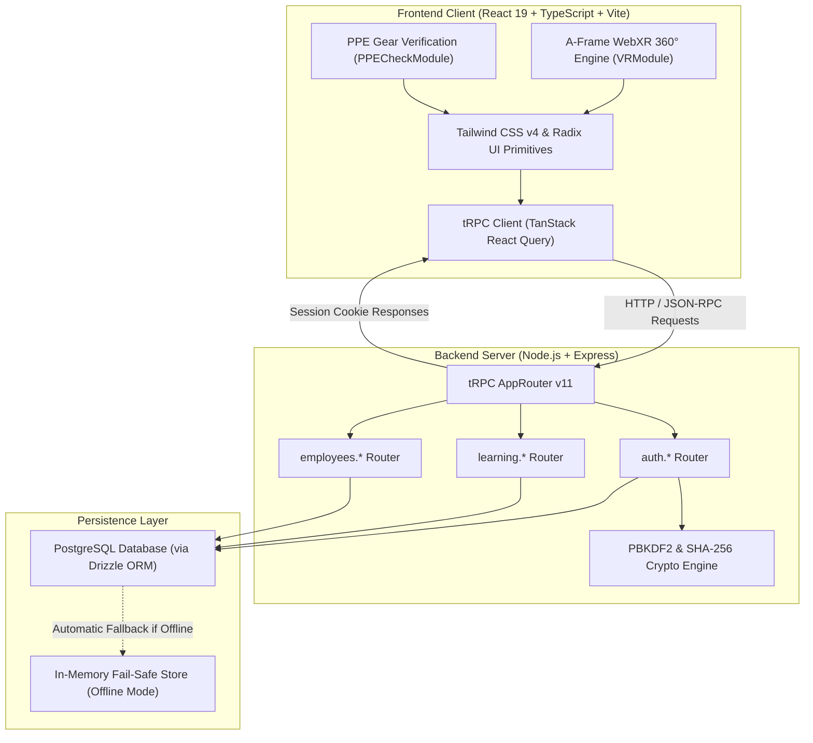
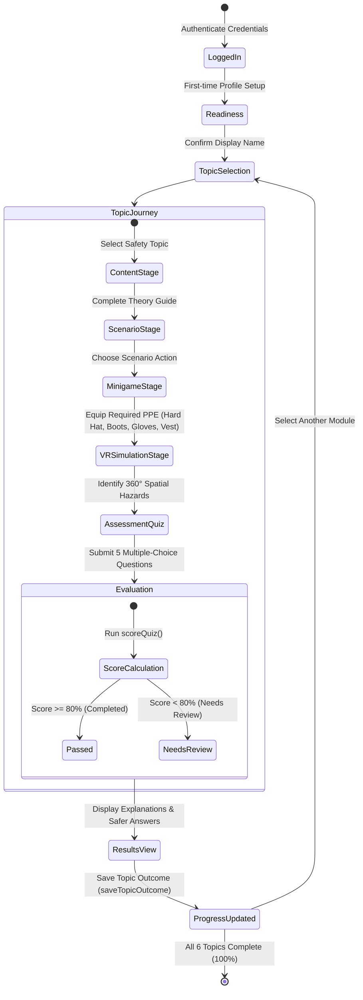
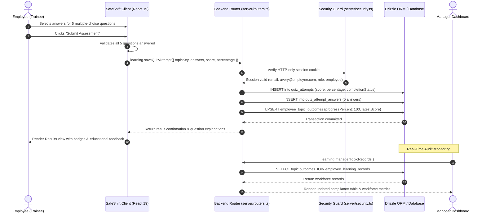
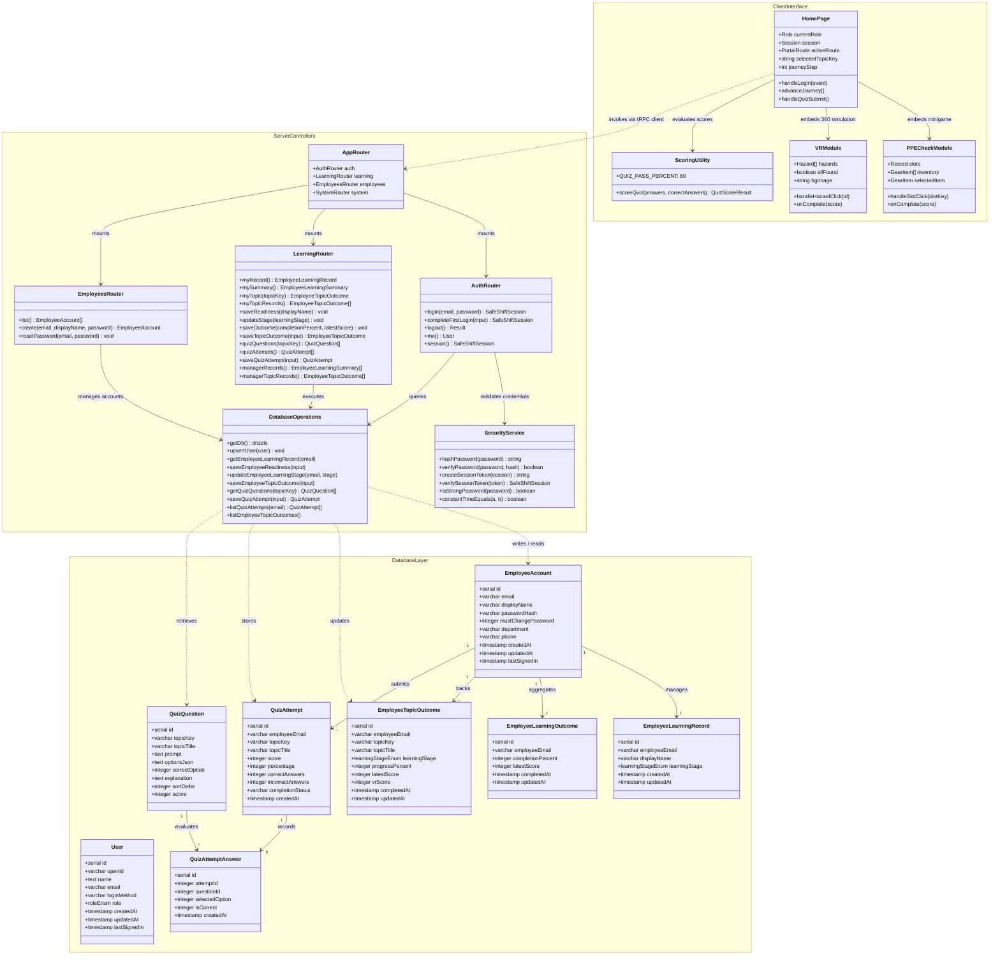
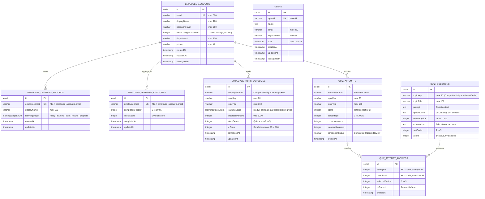
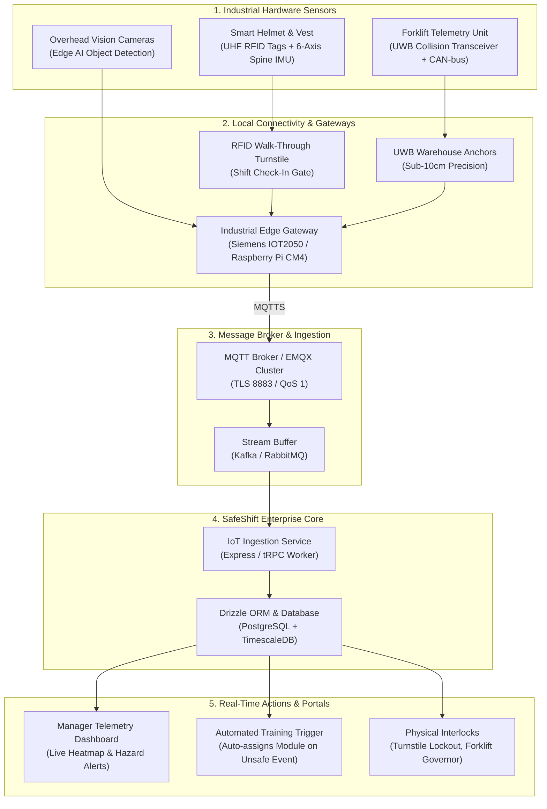

<p align="center">
  
</p>

# SafeShift 🛡️

> **Enterprise Occupational Health & Safety (WHS/OH&S) Training, WebXR Hazard Simulation & Workforce Compliance Platform**

[](https://react.dev/)
[](https://www.typescriptlang.org/)
[](https://vitejs.dev/)
[](https://tailwindcss.com/)
[](https://trpc.io/)
[](https://orm.drizzle.team/)
[](https://aframe.io/)
[](https://vitest.dev/)
[](LICENSE)

---

## 📌 1. Executive Summary

**SafeShift** is an interactive, enterprise-grade workplace health, safety, and regulatory compliance platform engineered for modern logistics, supply-chain hubs, and industrial warehousing facilities.

Traditional corporate safety induction relies on static slide decks and superficial multiple-choice questions. SafeShift modernizes mandatory safety education by combining:
1. **Active Procedural Learning**: 5-stage journeys connecting classroom safety rules to real floor operations.
2. **Interactive Hands-On Simulations**: Drag-and-drop pre-shift PPE gear verification (`PPECheckModule`).
3. **Spatial 360° WebXR Hazard Perception**: Immersive spatial exploration using A-Frame (`VRModule`) to detect floor spills, rack overloads, and blocked fire exits.
4. **Workforce Compliance Oversight**: Real-time manager dashboard calibrated for a 50-person benchmark workforce, tracking completion rates and quiz scores.
5. **Fail-Safe Dual-Mode Persistence**: PostgreSQL via Drizzle ORM paired with an automatic in-memory fallback for seamless offline testing.

---

## 👥 2. Role-Based Portals

| Role | Primary User Journey | Core Capabilities |
| :--- | :--- | :--- |
| **Employee (Trainee)** | Learner Hub $\rightarrow$ 6 Safety Modules $\rightarrow$ PPE Check $\rightarrow$ 360° VR $\rightarrow$ Quiz $\rightarrow$ History | Self-paced onboarding, interactive scenario decisions, gamified equipment validation, real-time score calculation, and progress records. |
| **Manager** | Workforce Overview $\rightarrow$ Topic Breakdowns $\rightarrow$ Audit Drill-Down $\rightarrow$ Workforce Provisioning | Real-time monitoring across 50 benchmark employees, module completion bars, quiz score averages, outstanding training lists, employee provisioning & credential management. |


---

## 📚 3. The 6 Core Safety Modules

Every safety topic follows a standardized 5-stage learning progression:
$$\text{Content} \longrightarrow \text{Scenario} \longrightarrow \text{Minigame (PPE)} \longrightarrow \text{VR 360° Challenge} \longrightarrow \text{5-Question Quiz}$$

1. **Manual Handling** (`safe-choices`): Kinetic lifting methods, spine alignment, power zone, lifting weight thresholds, team lifts.
2. **Working at Height** (`working-at-height`): 3-point ladder contact, safety harness inspection, lanyard anchorages, mobile scaffold safety.
3. **Hazard Perception** (`hazard-perception`): Warehouse scanning patterns, blind-spot navigation, forklift-pedestrian corridor separation.
4. **Unsafe Acts** (`unsafe-acts`): Shortcut mitigation, safety interlock bypass rules, fatigue recognition, stop-work authority.
5. **Five Whys / Root Cause Analysis** (`five-whys`): Incident investigation techniques, systemic process fixes, recurring hazard prevention.
6. **Cyber Awareness in Logistics** (`cyber-awareness`): WMS terminal lockouts, badge security, barcode scanner tampering, social engineering defense.

---

## 📂 4. Complete Project File Structure

Below is the exhaustive file tree of the SafeShift repository:

```plaintext
2nd Safeshift website/
├── .env                                       # Environment configuration (DATABASE_URL, secrets, PORT)
├── .gitignore                                 # Git exclusions (node_modules, dist, .env, build caches)
├── .prettierrc / .prettierignore             # Formatting configuration and file exclusions
├── .project-config.json                       # IDE & workspace tooling metadata
├── components.json                            # Radix / shadcn UI design system manifest
├── drizzle.config.ts                          # Drizzle ORM migration and schema configuration
├── ideas.md                                   # Brand design identity ("Quiet Confidence") & style guide
├── logo.png                                   # High-resolution primary SafeShift branding logo
├── package.json                               # Dependencies, package metadata, and lifecycle scripts
├── pnpm-lock.yaml                             # Deterministic pnpm dependency lockfile
├── README.md                                  # Primary project documentation, UML, and operational guide
├── SAFE_SHIFT_REQUIREMENTS_TRACEABILITY.md   # Functional requirements audit (SS-01 to SS-17 verification)
├── SAFESHIFT_SYSTEM_OVERVIEW.md               # Exhaustive technical architecture, DB models & IoT blueprint
├── todo.md                                    # Feature checklist, milestones, and implementation history
├── tsconfig.json                              # Strict TypeScript configuration and alias path mappings
├── vite.config.ts                             # Vite frontend build pipeline, root configuration & aliases
│
├── client/                                    # Frontend Application (React 19, TypeScript, Vite)
│   ├── index.html                             # Single Page Application HTML shell
│   ├── public/                                # Static client assets
│   │   ├── safeshift-logo.png                 # Standard logo asset
│   │   ├── safeshift-logo-transparent.png     # Transparent logo asset (used in header & README)
│   │   └── safeshift-logo-alpha.png           # Alpha channel masked logo
│   └── src/
│       ├── main.tsx                           # Application entry point (ReactDOM.createRoot)
│       ├── App.tsx                            # Root React component, ThemeProvider & Route Switch
│       ├── const.ts                           # Client runtime constants & global configuration
│       ├── index.css                          # Global styles, Tailwind CSS v4 variables & custom keyframes
│       ├── vite-env.d.ts                      # Vite client environment typing (import.meta.env)
│       │
│       ├── components/                        # Functional & Domain Components
│       │   ├── PPECheckModule.tsx             # Interactive avatar gear check & slot verification
│       │   ├── VRModule.tsx                   # A-Frame WebXR 360° warehouse hazard perception engine
│       │   ├── AIChatBox.tsx                  # AI safety companion chat assistant
│       │   ├── Map.tsx                        # Facility map & incident hotspot visualization
│       │   ├── DashboardLayout.tsx            # Portal layout shell with sidebar navigation
│       │   ├── DashboardLayoutSkeleton.tsx    # Suspense skeleton for portal transitions
│       │   ├── ErrorBoundary.tsx              # Component crash boundary
│       │   ├── icons.tsx                      # SVG icon library wrappers
│       │   ├── ManusDialog.tsx                # Modal dialogue wrapper
│       │   │
│       │   └── ui/                            # 40+ Atomic Headless UI Primitives (Radix UI + Tailwind)
│       │       ├── accordion.tsx              # Collapsible accordion container
│       │       ├── alert.tsx / alert-dialog   # Banner alerts & modal confirmation dialogues
│       │       ├── aspect-ratio.tsx           # Proportional container
│       │       ├── avatar.tsx                 # Trainee avatar preview
│       │       ├── badge.tsx                  # Status and indicator badges
│       │       ├── breadcrumb.tsx             # Breadcrumb path navigation
│       │       ├── button.tsx / button-group  # Action button elements
│       │       ├── calendar.tsx               # Date selection calendar
│       │       ├── card.tsx                   # Content cards & widgets
│       │       ├── carousel.tsx               # Slider carousel
│       │       ├── chart.tsx                  # Recharts data visualization wrappers
│       │       ├── checkbox.tsx               # Accessible checkbox
│       │       ├── collapsible.tsx            # Collapsible layout section
│       │       ├── command.tsx                # Fast command search palette
│       │       ├── context-menu.tsx           # Right-click contextual menu
│       │       ├── dialog.tsx / drawer.tsx    # Modals & responsive drawer sliders
│       │       ├── dropdown-menu.tsx          # Dropdown menus
│       │       ├── empty.tsx                  # Empty state placeholder
│       │       ├── field.tsx / form.tsx       # Form wrappers with React Hook Form bindings
│       │       ├── hover-card.tsx             # Hover-activated card preview
│       │       ├── input.tsx / input-otp.tsx  # Text input and OTP fields
│       │       ├── item.tsx                   # List item container
│       │       ├── kbd.tsx                    # Keyboard shortcut tag
│       │       ├── label.tsx                  # Form field labels
│       │       ├── menubar.tsx                # Menu bar navigation
│       │       ├── navigation-menu.tsx        # Top-level navigation menu
│       │       ├── pagination.tsx             # Tabular pagination controls
│       │       ├── popover.tsx                # Contextual popovers
│       │       ├── progress.tsx               # Animated progress indicators
│       │       ├── radio-group.tsx            # Radio button groups
│       │       ├── resizable.tsx              # Split resizable panel containers
│       │       ├── scroll-area.tsx            # Custom scrollable viewports
│       │       ├── select.tsx                 # Select dropdowns
│       │       ├── separator.tsx              # Visual dividers
│       │       ├── sheet.tsx                  # Slide-over sheets
│       │       ├── sidebar.tsx                # Collapsible application sidebar
│       │       ├── skeleton.tsx               # Loading skeleton placeholders
│       │       ├── slider.tsx                 # Numeric slider controls
│       │       ├── sonner.tsx                 # Toast notifications
│       │       ├── spinner.tsx                # Loading spinner
│       │       ├── switch.tsx                 # Toggle switches
│       │       ├── table.tsx                  # Accessible data tables
│       │       ├── tabs.tsx                   # Tabbed navigation panels
│       │       ├── textarea.tsx               # Multiline inputs
│       │       ├── toggle.tsx / toggle-group  # Push toggles
│       │       └── tooltip.tsx                # Hover tooltips
│       │
│       ├── contexts/
│       │   └── ThemeContext.tsx               # Dark/Light theme state management
│       ├── hooks/
│       │   ├── useMobile.tsx                  # Mobile screen breakpoint detection
│       │   ├── useComposition.ts              # IME input composition handling
│       │   └── usePersistFn.ts                # Callback reference persistence
│       ├── lib/
│       │   ├── scoring.ts                     # Quiz score calculation, percentages, and pass checks
│       │   ├── scoring.test.ts                # Vitest unit tests for scoring algorithms
│       │   ├── trpc.ts                        # tRPC client instance with React Query bindings
│       │   └── utils.ts                       # ClassName resolution (clsx + twMerge)
│       ├── pages/
│       │   ├── Home.tsx                       # Master unified view (Auth, Employee, Manager)
│       │   └── NotFound.tsx                   # 404 error page
│       └── _core/
│           └── hooks/
│               └── useAuth.ts                 # Session and authentication hooks
│
├── server/                                    # Backend Application (Node.js + Express + tRPC)
│   ├── index.ts                               # Production Express entry point
│   ├── accounts.ts                            # Credential validation, password hashing, in-memory store
│   ├── auth.logout.test.ts                    # Integration tests for logout & cookie invalidation
│   ├── auth.router.test.ts                    # Integration tests for login, sessions & rate limiting
│   ├── db.ts                                  # Database connection pool and Drizzle ORM query layer
│   ├── learning.router.test.ts                # Integration tests for learning procedures & authorization
│   ├── quizCatalog.ts                         # Hardcoded master catalog of 6 safety topics & 30 questions
│   ├── quizCatalog.test.ts                    # Tests for question schema integrity & answer validation
│   ├── routers.ts                             # Main tRPC AppRouter (auth, employees, learning)
│   ├── security.ts                            # Cryptography, PBKDF2 hashing, session tokens
│   ├── storage.ts                             # S3/Cloud object storage interface
│   └── _core/                                 # Server Infrastructure & Middleware
│       ├── context.ts                         # tRPC request context extractor
│       ├── cookies.ts                         # HTTP cookie options & parsing
│       ├── env.ts                             # Environment variable parser
│       ├── index.ts                           # Server startup orchestrator & port resolution
│       ├── notification.ts                    # Notification dispatchers
│       ├── oauth.ts                           # OAuth route handlers
│       ├── sdk.ts                             # Core SDK bindings
│       ├── storageProxy.ts                    # Storage proxy handlers
│       ├── systemRouter.ts                    # Diagnostic tRPC procedures
│       ├── trpc.ts                            # tRPC initialization, middleware & role procedures
│       ├── vite.ts                            # Development Vite HMR middleware integration
│       └── types/
│           ├── cookie.d.ts                    # Ambient cookie typing
│           └── manusTypes.ts                  # Internal system types
│
├── shared/                                    # Shared Isomorphic Contracts & Constants
│   ├── const.ts                               # Session cookie keys, pass thresholds, topic keys
│   ├── types.ts                               # Shared DTOs between client and server
│   └── _core/
│       └── errors.ts                          # Unified application error types
│
├── drizzle/                                   # Database Migrations & Schemas
│   ├── schema.ts                              # Drizzle ORM schema definitions & PostgreSQL enums
│   ├── relations.ts                           # Relational join definitions
│   ├── 0000_dusty_joseph.sql                  # Initial database migration
│   ├── 0001_great_sunfire.sql                 # Migration for topic outcomes & VR scores
│   └── meta/                                  # Migration journals & schema snapshots
│
└── patches/                                   # Dependency Patches
    └── wouter@3.7.1.patch                     # Custom path patch for wouter routing library
```

---

## 📐 5. UML Diagrams

### 5.1 System Component & Data Flow Architecture



---

### 5.2 UML State Diagram: Learner Journey Progression



---

### 5.3 UML Sequence Diagram: Assessment Submission & Compliance Audit



---

### 5.4 Comprehensive Project-Based UML Class Diagram

This diagram maps the application's **actual database models**, **backend service routers**, and **interactive frontend components**:



---

## 🗄️ 6. Database Architecture & Schema

The persistence layer is managed by **Drizzle ORM** connected to a PostgreSQL database, defined in [drizzle/schema.ts](file:///c:/Users/ROG%20STRIX/Desktop/2nd%20Safeshift%20website/drizzle/schema.ts) and executed via [server/db.ts](file:///c:/Users/ROG%20STRIX/Desktop/2nd%20Safeshift%20website/server/db.ts).

### 6.1 Database Entity-Relationship (ER) Diagram



---

### 6.2 Detailed Table Specifications

#### 1. `users`
SSO, OpenID Connect, and global system administration records.
- `id` (Serial, Primary Key)
- `openId` (Varchar 64, Unique, Not Null): Identity provider unique subject.
- `name` (Text): Full user name.
- `email` (Varchar 320): User email address.
- `loginMethod` (Varchar 64): Identity provider method.
- `role` (Enum `roleEnum`: `'user'`, `'admin'`, Default: `'user'`).
- `createdAt`, `updatedAt`, `lastSignedIn` (Timestamps).

#### 2. `employee_accounts`
Worker credentials and organizational metadata.
- `id` (Serial, Primary Key)
- `email` (Varchar 320, Unique, Not Null): Login identifier.
- `displayName` (Varchar 120, Default: `'Employee'`): Display name for reporting.
- `passwordHash` (Varchar 200, Not Null): Salted PBKDF2 password hash.
- `mustChangePassword` (Integer, Default: `1`): Flag forcing password change on initial sign-in.
- `department` (Varchar 120, Nullable): Warehouse department (e.g. *Inbound Receiving*).
- `phone` (Varchar 40, Nullable): Contact phone number.
- `createdAt`, `updatedAt`, `lastSignedIn` (Timestamps).

#### 3. `employee_learning_records`
High-level onboarding lifecycle tracker.
- `id` (Serial, Primary Key)
- `employeeEmail` (Varchar 320, Unique, Not Null): Unique reference to employee email.
- `displayName` (Varchar 120, Not Null)
- `learningStage` (Enum `learningStageEnum`: `'ready'`, `'training'`, `'quiz'`, `'results'`, `'progress'`).
- `createdAt`, `updatedAt` (Timestamps).

#### 4. `employee_learning_outcomes`
Aggregated overall curriculum metrics across all topics.
- `id` (Serial, Primary Key)
- `employeeEmail` (Varchar 320, Unique, Not Null)
- `completionPercent` (Integer, Default: `0`): Overall curriculum percentage (0–100%).
- `latestScore` (Integer, Nullable): Latest aggregate quiz score.
- `completedAt` (Timestamp, Nullable): Set when 100% completion is reached.
- `updatedAt` (Timestamp).

#### 5. `employee_topic_outcomes`
Granular, per-topic progress and simulation scores across the 6 core safety topics.
- `id` (Serial, Primary Key)
- `employeeEmail` (Varchar 320, Not Null)
- `topicKey` (Varchar 80, Not Null): Topic identifier (`safe-choices`, `hazard-perception`, etc.).
- `topicTitle` (Varchar 160, Not Null)
- `learningStage` (Enum `learningStageEnum`, Default: `'ready'`)
- `progressPercent` (Integer, Default: `0`)
- `latestScore` (Integer, Nullable): Multiple-choice quiz score (0–5).
- `vrScore` (Integer, Nullable): A-Frame WebXR simulation score (0–100).
- `completedAt` (Timestamp, Nullable)
- `updatedAt` (Timestamp)
- *Constraint*: `UNIQUE(employeeEmail, topicKey)`.

#### 6. `quiz_questions`
Master question bank for all 6 safety curriculum topics.
- `id` (Serial, Primary Key)
- `topicKey` (Varchar 80, Not Null)
- `topicTitle` (Varchar 160, Not Null)
- `prompt` (Text, Not Null): The safety question prompt text.
- `optionsJson` (Text, Not Null): JSON-serialized array of 4 multiple-choice options.
- `correctOption` (Integer, Not Null): Zero-based index (0, 1, 2, or 3) of the correct choice.
- `explanation` (Text, Not Null): Educational rationale and safety rule explanation.
- `sortOrder` (Integer, Not Null): Question sequence index (1 to 5).
- `active` (Integer, Default: `1`): Active flag.
- *Constraint*: `UNIQUE(topicKey, sortOrder)`.

#### 7. `quiz_attempts`
Immutable audit log of all completed quiz attempts.
- `id` (Serial, Primary Key)
- `employeeEmail` (Varchar 320, Not Null)
- `topicKey` (Varchar 80, Not Null)
- `topicTitle` (Varchar 160, Not Null)
- `score` (Integer, Not Null): Total correct answers (e.g. 4).
- `percentage` (Integer, Not Null): Calculated percentage (e.g. 80%).
- `correctAnswers` (Integer, Not Null)
- `incorrectAnswers` (Integer, Not Null)
- `completionStatus` (Varchar 40, Not Null): `'Completed'` ($\ge 80\%$) or `'Needs Review'` ($< 80\%$).
- `createdAt` (Timestamp, Default: Now).

#### 8. `quiz_attempt_answers`
Detailed per-question responses for each quiz attempt.
- `id` (Serial, Primary Key)
- `attemptId` (Integer, Not Null): Foreign Key referencing `quiz_attempts.id`.
- `questionId` (Integer, Not Null): Foreign Key referencing `quiz_questions.id`.
- `selectedOption` (Integer, Not Null): The option index selected by the employee.
- `isCorrect` (Integer, Not Null): 1 if correct, 0 if incorrect.
- `createdAt` (Timestamp, Default: Now).

---

## 📡 7. Industrial IoT (IIoT) Integration Architecture

SafeShift connects interactive software modules with physical **Smart Warehouse & Industrial IoT** ecosystems:



### 7.1 How IoT Connects to SafeShift Code
- **Smart PPE Turnstile Scanning** $\longleftrightarrow$ [client/src/components/PPECheckModule.tsx](file:///c:/Users/ROG%20STRIX/Desktop/2nd%20Safeshift%20website/client/src/components/PPECheckModule.tsx): Physical RFID gates scan worker PPE (helmet, vest, gloves, boots). If any tag is missing, entry is held and the trainee resolves the requirement through the PPE Check Module.
- **Computer Vision Spatial Digital Twins** $\longleftrightarrow$ [client/src/components/VRModule.tsx](file:///c:/Users/ROG%20STRIX/Desktop/2nd%20Safeshift%20website/client/src/components/VRModule.tsx): 360° A-Frame panoramic scenes replicate overhead Edge AI camera detections of aisle spills, pallet overloads, and blocked exits.
- **Ergonomics & Spine Angle Wearables**: IMU sensors on workers detect trunk flexion $>60^\circ$ and log repeated awkward lifts over MQTT to automatically assign the **Manual Handling** refresher module.
- **Forklift Collision Avoidance**: Ultra-Wideband (UWB) distance beacons detect pedestrian-forklift proximity within 3 meters and plot risk hotspots on [client/src/components/Map.tsx](file:///c:/Users/ROG%20STRIX/Desktop/2nd%20Safeshift%20website/client/src/components/Map.tsx).

---

## 🚀 8. How to Run the Application

### 8.1 Prerequisites
- **Node.js**: $\ge 20.x$ (Tested and verified on Node.js v24.18)
- **pnpm**: $\ge 10.x$ (or npm v11.x)
- **Modern Web Browser**: Google Chrome, Microsoft Edge, or Mozilla Firefox (with WebXR/WebGL enabled for 360° simulations)

---

### 8.2 Installation

```powershell
# 1. Clone the repository
git clone https://github.com/rajeshkarki9/SafeShift.git
cd SafeShift

# 2. Install all dependencies with pnpm
pnpm install
```

---

### 8.3 Running the Application

#### Option A: Production Build & Run (Fastest & Recommended)
This compiles both the frontend client and backend server into `dist/` and runs the production Express service:
```powershell
# Build frontend and server bundles
pnpm run build

# Start the production server on http://localhost:3000
pnpm start
```
Open your browser and navigate to: **`http://localhost:3000/`**

#### Option B: Development Mode (Hot-Module Replacement)
Use this when modifying code and viewing live changes:
```powershell
pnpm run dev
```
Open your browser and navigate to: **`http://localhost:3000/`**

#### Option C: Standalone Zero-Dependency Demo
To run the interactive 3D WebXR hazard perception and PPE check without running Node.js:
- Open `demo/index.html` directly in any web browser.

---

### 8.4 Verification & Testing

SafeShift includes automated unit and integration tests covering scoring algorithms, authentication, logout cookie handling, and learning procedures:

```powershell
# 1. Run client-side scoring tests
pnpm test

# 2. Run the entire test suite across client and server (20/20 tests)
npx vitest run --root .

# 3. Run TypeScript typecheck without emitting files
pnpm run check
```

---

## 🔑 9. Demo Login Credentials

Once the application is running on `http://localhost:3000/`, use these pre-configured credentials to test all role portals:

| Role | Email Address | Password | Intended Portal Flow |
| :--- | :--- | :--- | :--- |
| **Employee (Trainee)** | `avery@employee.com` | `safeshift123` | Learner Hub $\rightarrow$ 6 Safety Modules $\rightarrow$ PPE Check Minigame $\rightarrow$ 360° VR Simulation $\rightarrow$ 5-Question Quiz $\rightarrow$ Score Feedback & History. |
| **Employee (Alt)** | `blake@employee.com` | `safeshift123` | Second employee profile with independent progression tracking. |
| **Manager** | `manager@safeshift.com` | `manager123` | Workforce Compliance Dashboard (50-employee workforce metrics, completion bars, audit drill-downs, and employee account provisioning). |

> [!NOTE]
> The server incorporates an automatic **in-memory data store**. You do **not** need an active PostgreSQL instance running to log in, complete modules, or record quiz scores during local testing.

---

## 📄 10. License

This project is licensed under the **MIT License**.
