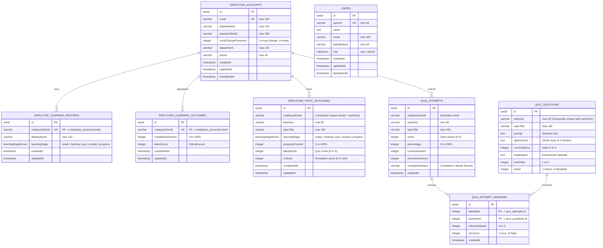
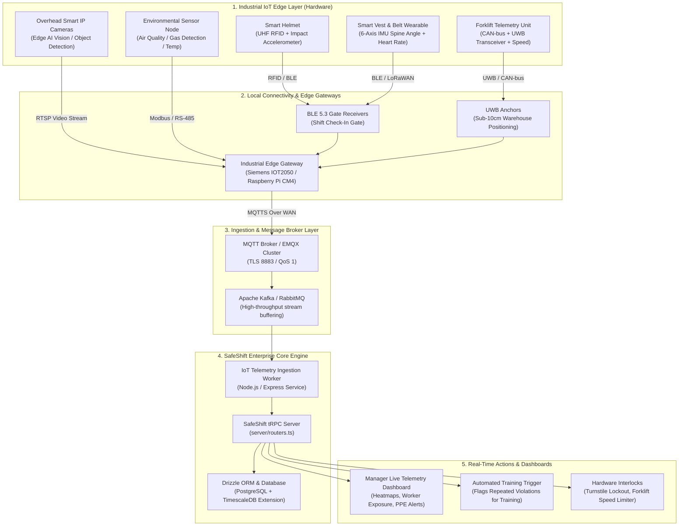

# SafeShift: Comprehensive System Overview, File Structure, Database Architecture & Industrial IoT Integration

---

## 1. Executive Project Overview

### 1.1 Purpose & Vision
SafeShift is an enterprise-grade workplace health, safety, and compliance platform tailored for modern warehousing, logistics, and industrial supply chain operations. The system transforms mandatory compliance training into an active, verified, multi-stage learning experience. It connects classroom concepts directly to shop-floor safety by combining:
- **Interactive Multi-Stage Learning Journeys**: Structured progression covering *Instructional Content*, *Contextual Scenarios*, *Gamified PPE Gear Checks*, *Spatial Hazard Perception (360°/VR)*, *5-Question Assessment Quizzes*, and *Instant Explanatory Feedback*.
- **Role-Based Portals**:
  1. **Employee (Trainee)**: Self-service profile readiness, individual topic progression, hands-on simulation modules, and historical quiz result archives.
  2. **Manager**: Real-time workforce compliance monitoring, completion audits across a standard 50-person workforce, topic-by-topic progress tables, and performance drill-downs.
  3. **Administrator**: Trainee account provisioning, credential management, forced password rotation, and curriculum governance.
- **Fail-Safe Operational Architecture**: End-to-end type safety powered by tRPC v11 and Drizzle ORM against PostgreSQL, with an automatic in-memory fallback layer for seamless offline and local development.

---

### 1.2 Technology Stack

| Layer | Technologies | Key Roles & Capabilities |
| :--- | :--- | :--- |
| **Frontend Framework** | React 19, TypeScript, Vite | Fast Single-Page Application (SPA) with React 19 concurrent features. |
| **Routing** | Wouter | Lightweight, declarative client-side route handling. |
| **Styling & UI Components** | Tailwind CSS v4, Radix UI Primitives, Lucide Icons, Framer Motion | Accessible headless components, responsive layouts, animated visual feedback. |
| **Spatial Simulation & 3D** | A-Frame (WebVR / WebXR) | In-browser 360° panoramic warehouse environment with gaze/cursor raycasting. |
| **Backend Framework** | Node.js, Express | Production HTTP service, static client serving, and middleware integration. |
| **API & Data Protocol** | tRPC v11, Zod | End-to-end type safety, runtime schema validation, procedure guards. |
| **Database & ORM** | PostgreSQL, Drizzle ORM, Drizzle Kit | Relational storage, schema migrations, and type-safe database queries. |
| **Authentication & Security**| HTTP-only Session Cookies, PBKDF2/SHA-256 Hashing | Role-based authorization, rate-limiting, and constant-time string comparisons. |
| **Testing** | Vitest | Automated unit testing for scoring algorithms, session logout, and route guards. |

---

## 2. Complete Project File Structure

Below is the directory map of the entire SafeShift repository:

```plaintext
2nd Safeshift website/
│
├── .env                                       # Environment config (DATABASE_URL, JWT secret, session configuration)
├── .gitignore                                 # Git exclusion rules for node_modules, build artifacts, and env files
├── .prettierrc / .prettierignore             # Code formatting rules and exclusions
├── .project-config.json                       # IDE and project metadata configuration
├── components.json                            # Radix / shadcn UI component configuration
├── drizzle.config.ts                          # Drizzle ORM migration generator and database dialect setup
├── package.json                               # Application dependencies, scripts, and package metadata
├── pnpm-lock.yaml                             # Deterministic dependency lockfile
├── tsconfig.json                              # TypeScript compiler settings, paths, and strict checking rules
├── vite.config.ts                             # Vite frontend bundler and plugin configuration
├── SAFE_SHIFT_REQUIREMENTS_TRACEABILITY.md   # Functional requirements audit & verification matrix
├── ideas.md                                   # Brand identity notes ("Quiet Confidence") and UI philosophy
├── todo.md                                    # Implementation checklist, milestones, and task audit trail
├── logo.png                                   # Primary branding logo
│
├── client/                                    # Frontend Application (React 19 + TypeScript)
│   ├── index.html                             # SPA HTML shell and viewport configuration
│   ├── public/                                # Static client assets
│   │   ├── safeshift-logo.png                 # Standard logo asset
│   │   ├── safeshift-logo-transparent.png     # Transparent branded logo
│   │   └── safeshift-logo-alpha.png           # Alpha channel mask logo
│   └── src/
│       ├── main.tsx                           # Application mount point (ReactDOM.createRoot)
│       ├── App.tsx                            # Root component, ThemeProvider & Route Switch
│       ├── const.ts                           # Global client runtime constants
│       ├── index.css                          # Global stylesheet, Tailwind CSS v4 variables & design tokens
│       │
│       ├── components/                        # Functional & Domain Components
│       │   ├── PPECheckModule.tsx             # Interactive drag-and-drop avatar safety equipment check
│       │   ├── VRModule.tsx                   # A-Frame WebXR 360° warehouse hazard perception engine
│       │   ├── AIChatBox.tsx                  # AI safety companion dialog
│       │   ├── Map.tsx                        # Facility mapping and site visualization component
│       │   ├── DashboardLayout.tsx            # Portal layout wrapper with sidebar and header
│       │   ├── DashboardLayoutSkeleton.tsx    # Suspense loading skeleton for portal navigation
│       │   ├── ErrorBoundary.tsx              # React Error Boundary for crash interception
│       │   ├── icons.tsx                      # SVG icon wrappers and iconography
│       │   ├── ManusDialog.tsx                # Modal container for system dialogues
│       │   │
│       │   └── ui/                            # Atomic Headless UI Primitives (Radix UI + Tailwind)
│       │       ├── accordion.tsx              # Collapsible panels
│       │       ├── alert.tsx / alert-dialog.tsx# Alert banners and modal confirmation dialogues
│       │       ├── aspect-ratio.tsx           # Fixed-ratio container
│       │       ├── avatar.tsx                 # User profile avatar thumbnail
│       │       ├── badge.tsx                  # Status and indicator badges
│       │       ├── breadcrumb.tsx             # Breadcrumb path navigation
│       │       ├── button.tsx / button-group.tsx # Styled action buttons
│       │       ├── calendar.tsx               # Date selection calendar
│       │       ├── card.tsx                   # Content container cards
│       │       ├── carousel.tsx               # Content carousel slider
│       │       ├── chart.tsx                  # Recharts data visualization wrappers
│       │       ├── checkbox.tsx               # Accessible checkbox input
│       │       ├── collapsible.tsx            # Collapsible layout section
│       │       ├── command.tsx                # Fast command palette search
│       │       ├── context-menu.tsx           # Right-click contextual menu
│       │       ├── dialog.tsx / drawer.tsx    # Modal windows and slide-over drawers
│       │       ├── dropdown-menu.tsx          # Contextual dropdown menus
│       │       ├── form.tsx / field.tsx       # Form wrappers with react-hook-form bindings
│       │       ├── hover-card.tsx             # Hover-activated card preview
│       │       ├── input.tsx / input-otp.tsx  # Text and OTP input fields
│       │       ├── label.tsx                  # Accessible form field labels
│       │       ├── menubar.tsx / navigation-menu.tsx # Desktop navigation bars
│       │       ├── pagination.tsx             # Table and list pagination
│       │       ├── popover.tsx                # Floating contextual popovers
│       │       ├── progress.tsx               # Percentage progress bars
│       │       ├── radio-group.tsx            # Radio option groups
│       │       ├── resizable.tsx              # Resizable panel layouts
│       │       ├── scroll-area.tsx            # Custom scrollable viewport
│       │       ├── select.tsx                 # Custom select dropdown
│       │       ├── separator.tsx              # Visual horizontal/vertical rule
│       │       ├── sheet.tsx                  # Side-sheet drawer
│       │       ├── sidebar.tsx                # Collapsible application sidebar
│       │       ├── skeleton.tsx               # Placeholder loading bones
│       │       ├── slider.tsx                 # Draggable value slider
│       │       ├── sonner.tsx                 # Toast notifications
│       │       ├── switch.tsx                 # Toggle switch component
│       │       ├── table.tsx                  # Accessible tabular data view
│       │       ├── tabs.tsx                   # Tabbed content container
│       │       ├── textarea.tsx               # Multiline text input
│       │       ├── toggle.tsx / toggle-group.tsx # Push-button toggles
│       │       └── tooltip.tsx                # Hover tooltips
│       │
│       ├── contexts/
│       │   └── ThemeContext.tsx               # Light/Dark mode state management
│       ├── hooks/
│       │   ├── useMobile.tsx                  # Screen breakpoint detection hook
│       │   ├── useComposition.ts              # IME composition state handling
│       │   └── usePersistFn.ts                # Callback reference persistence
│       ├── lib/
│       │   ├── scoring.ts                     # Quiz score calculation, percentages, and pass determination
│       │   ├── scoring.test.ts                # Unit tests for scoring math and edge cases
│       │   ├── trpc.ts                        # tRPC client instance and React Query bindings
│       │   └── utils.ts                       # ClassName resolution (clsx + twMerge)
│       └── pages/
│           ├── Home.tsx                       # Unified Portal page (Auth, Learner, Manager, Admin flows)
│           └── NotFound.tsx                   # 404 page
│
├── server/                                    # Backend Application (Node.js + Express + tRPC)
│   ├── index.ts                               # Production server entry point
│   ├── accounts.ts                            # User authentication logic, seed accounts, in-memory store
│   ├── auth.logout.test.ts                    # Unit tests verifying logout and cookie invalidation
│   ├── auth.router.test.ts                    # Unit tests for login, session queries, and rate-limiting
│   ├── db.ts                                  # Database connection pool and Drizzle ORM query layer
│   ├── learning.router.test.ts                # Unit tests for trainee progress and quiz submission
│   ├── quizCatalog.ts                         # Hardcoded catalog of 6 core safety topics & 30 total questions
│   ├── quizCatalog.test.ts                    # Validation test suite for question counts & schema integrity
│   ├── routers.ts                             # Root tRPC AppRouter (Auth, Employees, Learning namespaces)
│   ├── security.ts                            # Password hashing, PBKDF2 cryptography, session token signing
│   ├── storage.ts                             # Object storage interface
│   └── _core/                                 # Infrastructure & Runtime Core
│       ├── context.ts                         # Express request context builder for tRPC
│       ├── cookies.ts                         # Cookie helper options and parsing
│       ├── dataApi.ts                         # Data fetching adapters
│       ├── env.ts                             # Environment variable loading & validation
│       ├── heartbeat.ts                       # Server health-check utilities
│       ├── notification.ts                    # System notifications
│       ├── systemRouter.ts                    # Health & system diagnostic tRPC procedures
│       ├── trpc.ts                            # tRPC initialization, middleware, and protected procedures
│       └── vite.ts                            # Development Vite HMR middleware integration
│
├── shared/                                    # Isomorphic Shared Definitions
│   ├── const.ts                               # Global constants (cookie keys, pass mark thresholds)
│   ├── types.ts                               # Type definitions shared between frontend and backend
│   └── _core/errors.ts                        # Unified error handling types
│
├── drizzle/                                   # Database Migrations and Schemas
│   ├── schema.ts                              # Drizzle ORM schema definitions and PostgreSQL enums
│   ├── relations.ts                           # Relational join definitions
│   ├── 0000_dusty_joseph.sql                  # Initial schema migration script
│   ├── 0001_great_sunfire.sql                 # Migration adding topic outcomes and simulation scores
│   └── meta/                                  # Migration journals and schema snapshots
│
└── demo/ & demo-static/                       # Standalone Offline Prototype Builds
    ├── index.html                             # Zero-dependency vanilla HTML5 demonstration
    ├── script.js                              # Drag-and-drop PPE check & A-Frame WebXR script
    └── style.css                              # Standalone visual styling
```

---

## 3. Database Architecture & Schema

SafeShift uses **Drizzle ORM** with PostgreSQL. If a live database connection is unavailable during development, [server/accounts.ts](file:///c:/Users/ROG%20STRIX/Desktop/2nd%20Safeshift%20website/server/accounts.ts) and [server/db.ts](file:///c:/Users/ROG%20STRIX/Desktop/2nd%20Safeshift%20website/server/db.ts) automatically switch to a memory-backed store to prevent service interruptions.

### 3.1 Entity Relationship Diagram



---

### 3.2 Detailed Database Table Specifications

#### 1. `users`
System administrative and OpenID Connect / SSO users.
- `id` (Serial, Primary Key)
- `openId` (Varchar 64, Unique, Not Null): Identity provider unique subject.
- `name` (Text): Full user name.
- `email` (Varchar 320): User email address.
- `loginMethod` (Varchar 64): OAuth / SSO method.
- `role` (Enum `role`: `user`, `admin`, Default: `user`).
- `createdAt`, `updatedAt`, `lastSignedIn` (Timestamps).

#### 2. `employee_accounts`
Worker credentials and organizational metadata for warehouse trainees.
- `id` (Serial, Primary Key)
- `email` (Varchar 320, Unique, Not Null): Unique login identifier.
- `displayName` (Varchar 120, Default: `'Employee'`): Name displayed on reports.
- `passwordHash` (Varchar 200, Not Null): Salted and hashed password.
- `mustChangePassword` (Integer, Default: `1`): Flag forcing credential change on initial sign-in.
- `department` (Varchar 120, Nullable): Operational unit (e.g. *Inbound Receiving*, *Forklift Fleet*).
- `phone` (Varchar 40, Nullable): Contact phone number.
- `createdAt`, `updatedAt`, `lastSignedIn` (Timestamps).

#### 3. `employee_learning_records`
High-level state tracker for an employee's onboarding journey.
- `id` (Serial, Primary Key)
- `employeeEmail` (Varchar 320, Unique, Not Null): References employee account.
- `displayName` (Varchar 120, Not Null)
- `learningStage` (Enum `learningStage`: `'ready'`, `'training'`, `'quiz'`, `'results'`, `'progress'`).
- `createdAt`, `updatedAt` (Timestamps).

#### 4. `employee_learning_outcomes`
Aggregated overall training metrics across the entire curriculum.
- `id` (Serial, Primary Key)
- `employeeEmail` (Varchar 320, Unique, Not Null)
- `completionPercent` (Integer, Default: `0`): Overall program completion (0–100%).
- `latestScore` (Integer, Nullable): Latest aggregate quiz score.
- `completedAt` (Timestamp, Nullable): Set when all modules reach 100%.
- `updatedAt` (Timestamp).

#### 5. `employee_topic_outcomes`
Granular, per-topic progress and simulation scores across the 6 core training modules.
- `id` (Serial, Primary Key)
- `employeeEmail` (Varchar 320, Not Null)
- `topicKey` (Varchar 80, Not Null): Identifies module (`safe-choices`, `hazard-perception`, etc.).
- `topicTitle` (Varchar 160, Not Null)
- `learningStage` (Enum `learningStage`, Default: `'ready'`)
- `progressPercent` (Integer, Default: `0`)
- `latestScore` (Integer, Nullable): Theoretical quiz score (0–5).
- `vrScore` (Integer, Nullable): Simulation performance score (0–100).
- `completedAt` (Timestamp, Nullable)
- `updatedAt` (Timestamp)
- *Constraint*: `UNIQUE(employeeEmail, topicKey)`.

#### 6. `quiz_questions`
The curriculum question bank containing questions, options, and explanations.
- `id` (Serial, Primary Key)
- `topicKey` (Varchar 80, Not Null)
- `topicTitle` (Varchar 160, Not Null)
- `prompt` (Text, Not Null): The safety question prompt.
- `optionsJson` (Text, Not Null): JSON-serialized array of 4 multiple-choice options.
- `correctOption` (Integer, Not Null): Zero-based index (0, 1, 2, or 3) of the correct choice.
- `explanation` (Text, Not Null): Explanatory feedback shown post-submission.
- `sortOrder` (Integer, Not Null): Sequence index within the topic (1 to 5).
- `active` (Integer, Default: `1`): Toggle for content visibility.
- *Constraint*: `UNIQUE(topicKey, sortOrder)`.

#### 7. `quiz_attempts`
Audit log of every submitted quiz attempt for safety compliance records.
- `id` (Serial, Primary Key)
- `employeeEmail` (Varchar 320, Not Null)
- `topicKey` (Varchar 80, Not Null)
- `topicTitle` (Varchar 160, Not Null)
- `score` (Integer, Not Null): Total correct answers (e.g. 4).
- `percentage` (Integer, Not Null): Calculated percentage (e.g. 80%).
- `correctAnswers` (Integer, Not Null)
- `incorrectAnswers` (Integer, Not Null)
- `completionStatus` (Varchar 40, Not Null): `'Completed'` ($\ge 80\%$) or `'Needs Review'` ($< 80\%$).
- `createdAt` (Timestamp, Default: Now).

#### 8. `quiz_attempt_answers`
Detailed per-question responses for each quiz attempt.
- `id` (Serial, Primary Key)
- `attemptId` (Integer, Not Null): Foreign Key referencing `quiz_attempts.id`.
- `questionId` (Integer, Not Null): Foreign Key referencing `quiz_questions.id`.
- `selectedOption` (Integer, Not Null): The option index selected by the employee.
- `isCorrect` (Integer, Not Null): 1 if correct, 0 if incorrect.
- `createdAt` (Timestamp, Default: Now).

---

## 4. Learning Curriculum & The 6 Core Safety Topics

SafeShift structures its training into **six modules**. Each topic follows a standardized 5-step path:

```
[1. Content] -> [2. Scenario] -> [3. Minigame / PPE Check] -> [4. Challenge / VR 360°] -> [5. Five-Question Quiz]
```

| # | Topic Key | Official Title | Core Competencies & Learning Objectives | Practical Simulation Element |
| :-: | :--- | :--- | :--- | :--- |
| **1** | `safe-choices` | **Manual Handling** | Kinetic lifting technique, load centre of gravity, power zone, lifting limits, spinal alignment. | **PPE Check Minigame**: Trainee equips protective gloves and steel-toe boots before manual tasks. |
| **2** | `working-at-height` | **Working at Height** | 3-point ladder contact, harness inspection, lanyard anchorage, mobile scaffold stability, edge protection. | Height safety harness inspection and lanyard anchor point verification. |
| **3** | `hazard-perception` | **Hazard Perception** | Spatial awareness, scanning patterns, detecting hidden risks, pedestrian-forklift separation. | **VR 360° Simulation**: Interactive panorama identifying liquid floor spills, leaning racks, and exit blocks. |
| **4** | `unsafe-acts` | **Unsafe Acts** | Shortcut culture, bypass of safety guards, distraction, horseplay, fatigue management, speaking up. | Peer intervention decision trees and stop-work authority challenges. |
| **5** | `five-whys` | **Five Whys / Root Cause**| Incident investigation, moving beyond surface symptoms, systemic fixes, preventing recurring failures. | Step-by-step interactive root-cause causal chain builder. |
| **6** | `cyber-awareness` | **Cyber Awareness in Logistics** | Warehouse Management System (WMS) terminal hygiene, phishing, badge sharing, barcode scanner tampering. | Social engineering identification and terminal auto-lock compliance. |

---

## 5. All Things on IoT (Internet of Things)

While SafeShift runs as a web application, its modules are designed to mirror **Smart Warehouse & Industrial IoT (IIoT)** safety ecosystems.

---

### 5.1 How IoT Connects to the Current Codebase

Two client-side components act as direct software representations of physical IoT devices:

```
+-------------------------------------------------------------------------------+
|                           Physical Warehouse Floor                            |
|                                                                               |
|   [ RFID / BLE Turnstile Gate ]               [ Overhead Edge AI Vision ]     |
|   Scans Worker Hard Hat & Boots               Detects Pallet Lean & Spills    |
+---------------------------------------+---------------------------------------+
                                        | (Hardware Telemetry)
                                        v
+-------------------------------------------------------------------------------+
|                       SafeShift Digital Counterparts                          |
|                                                                               |
|   client/src/components/PPECheckModule.tsx    client/src/components/VRModule  |
|   Interactive gear slot validation            A-Frame 360° hazard detection   |
+-------------------------------------------------------------------------------+
```

1. **`PPECheckModule.tsx` (Smart PPE & Gate Check)**:
   - *In Code*: Trainees must assign required equipment (**Hard Hat**, **High-Vis Vest**, **Protective Gloves**, and **Steel-Toed Boots**) to body slots before shift readiness is certified.
   - *Physical IoT Equivalent*: RFID and BLE-embedded personal protective equipment. Trainees walk through an RFID scanner gate (e.g. Zebra FX9600) connected to an optical turnstile. If any required tag is missing, gate entry is denied and an event is logged in SafeShift.

2. **`VRModule.tsx` (Spatial Digital Twin & Hazard Perception)**:
   - *In Code*: Renders an A-Frame 360° panoramic warehouse scene where users rotate the camera to find hazard hot-spots (e.g. liquid spills, unstable high-stacked boxes, blocked fire exits).
   - *Physical IoT Equivalent*: Industrial edge cameras running Computer Vision (YOLOv8 / TensorRT) coupled with ultrasonic height sensors on pallet racking to identify real-world aisle obstructions and rack overload in real time.

---

### 5.2 Industrial IoT Architecture for SafeShift

Below is the complete end-to-end architecture showing how physical IoT devices integrate with the SafeShift platform:



---

### 5.3 Three Real-World IoT Integration Modules

#### A. Smart Ergonomics & Spine Angle Sensor (Connected to `safe-choices`)
* **Physical Hardware**: A small sensor clip worn on the upper back/waist harness containing a 6-axis IMU (3-axis accelerometer + 3-axis gyroscope) with BLE connectivity.
* **Operational Flow**:
  1. The IMU measures trunk flexion and rotational twist during box lifting.
  2. Bending beyond $60^\circ$ without knee flexion triggers an onboard haptic vibration alert to remind the worker to adjust their posture.
  3. The sensor packages the event and sends it to the edge gateway over MQTT:
     ```json
     {
       "deviceId": "vest-imu-042",
       "employeeEmail": "avery@employee.com",
       "eventType": "ergonomic_hazard",
       "trunkFlexionAngle": 68.4,
       "twistingDetected": true,
       "timestamp": "2026-09-30T14:22:10Z"
     }
     ```
  4. If an employee logs more than 5 bad lifts in a single shift, SafeShift automatically schedules a targeted **Manual Handling** refresher module in their learner portal.

#### B. Forklift Proximity & Collision Avoidance (Connected to `hazard-perception`)
* **Physical Hardware**: Ultra-Wideband (UWB) transceiver tags clipped to high-visibility vests communicating with UWB transceiver anchors on forklift trucks.
* **Operational Flow**:
  1. UWB time-of-flight measurements provide real-time distance calculations with $\pm 10\text{ cm}$ precision.
  2. **Zone 1 (Warning, 5 metres)**: Forklift in-cab audio buzzer sounds; worker's vest flashes an amber LED.
  3. **Zone 2 (Critical Danger, 2.5 metres)**: Forklift speed governor triggers via CAN-bus to throttle maximum velocity to $3\text{ km/h}$.
  4. The near-miss incident is recorded in SafeShift's database, plotting risk hotspots on the warehouse map component in [Map.tsx](file:///c:/Users/ROG%20STRIX/Desktop/2nd%20Safeshift%20website/client/src/components/Map.tsx).

#### C. Smart PPE RFID Gate Verification (Connected to `PPECheckModule.tsx`)
* **Physical Hardware**: UHF Gen 2 RFID tags sewn into safety gear (vests, hard hats, steel-toe boots) and a walk-through portal antenna array at warehouse turnstiles.
* **Operational Flow**:
  1. The worker swipes their employee RFID badge at the entrance turnstile.
  2. The portal antenna array performs a 500ms RF sweep across all 4 mandatory equipment tags.
  3. If all 4 tags respond, the turnstile unlocks and updates the employee record.
  4. If any item is missing (e.g. gloves left in locker), the turnstile remains locked, and the worker's tablet displays the SafeShift **PPE Check Module** to resolve the missing equipment.

---

### 5.4 Proposed Database Extension for Live IoT Telemetry

To natively store streaming IoT sensor events alongside training outcomes, the Drizzle schema in [drizzle/schema.ts](file:///c:/Users/ROG%20STRIX/Desktop/2nd%20Safeshift%20website/drizzle/schema.ts) can be extended as follows:

```typescript
import { pgTable, serial, varchar, timestamp, jsonb, integer } from "drizzle-orm/pg-core";

// Registered Industrial IoT Hardware Registry
export const iotDevices = pgTable("iot_devices", {
  id: serial("id").primaryKey(),
  deviceId: varchar("deviceId", { length: 64 }).notNull().unique(), // e.g. "GATE-SCANNER-01", "FORKLIFT-UWB-12"
  deviceType: varchar("deviceType", { length: 50 }).notNull(),     // 'ppe_gate', 'forklift_proximity', 'imu_wearable'
  macAddress: varchar("macAddress", { length: 32 }),
  firmwareVersion: varchar("firmwareVersion", { length: 30 }),
  zoneLocation: varchar("zoneLocation", { length: 80 }).notNull(),  // e.g. "Loading Bay 3", "Racking Aisle B"
  lastHeartbeat: timestamp("lastHeartbeat").defaultNow().notNull(),
  status: varchar("status", { length: 20 }).default("online").notNull(),
});

// Telemetry & Safety Incident Event Log
export const iotSafetyEvents = pgTable("iot_safety_events", {
  id: serial("id").primaryKey(),
  deviceId: varchar("deviceId", { length: 64 }).notNull(),
  employeeEmail: varchar("employeeEmail", { length: 320 }),         // Linked if tag is assigned to a worker
  eventType: varchar("eventType", { length: 60 }).notNull(),        // 'ppe_violation', 'near_miss_proximity', 'ergonomic_hazard'
  severity: varchar("severity", { length: 20 }).notNull(),          // 'low', 'medium', 'high', 'critical'
  payload: jsonb("payload"),                                        // Raw sensor data: { angle: 68, forkliftId: "FL-02", distanceCm: 140 }
  autoAssignedTopicKey: varchar("autoAssignedTopicKey", { length: 80 }), // e.g. "safe-choices", "hazard-perception"
  resolvedAt: timestamp("resolvedAt"),
  createdAt: timestamp("createdAt").defaultNow().notNull(),
});
```

---

## 6. API & Service Architecture (tRPC Procedures)

SafeShift's backend provides end-to-end typed Remote Procedure Calls (tRPC) defined in [server/routers.ts](file:///c:/Users/ROG%20STRIX/Desktop/2nd%20Safeshift%20website/server/routers.ts).

### 6.1 Authentication (`auth.*`)
- `auth.session` *(Public Query)*: Retrieves current cookie session, role, and mandatory password rotation status.
- `auth.login` *(Public Mutation)*: Validates credentials, handles login failure rate-limiting, and issues HTTP-only session cookies.
- `auth.completeFirstLogin` *(Employee Mutation)*: Enforces new password creation and profile details on first sign-in.
- `auth.logout` *(Public Mutation)*: Clears session and demo cookies across domain paths.

### 6.2 Trainee Learning Operations (`learning.*`)
- `learning.myRecord` *(Employee Query)*: Returns the employee's current learning record and onboarding stage.
- `learning.myTopic` *(Employee Query)*: Retrieves progress and score for a specific topic module.
- `learning.myTopicRecords` *(Employee Query)*: Retrieves outcomes across all 6 topics for the authenticated user.
- `learning.saveReadiness` *(Employee Mutation)*: Updates user display name and begins training.
- `learning.saveTopicOutcome` *(Employee Mutation)*: Saves topic progress, theoretical scores, and VR simulation scores.
- `learning.quizQuestions` *(Public Query)*: Delivers the 5 questions for a requested topic key.
- `learning.quizAttempts` *(Employee Query)*: Returns past attempts and score histories.
- `learning.saveQuizAttempt` *(Employee Mutation)*: Validates question answers, verifies score against the 80% pass threshold, logs attempt records, and updates topic completion.

### 6.3 Manager Oversight (`learning.*`)
- `learning.managerRecords` *(Staff Query)*: Returns workforce summary across all registered employees.
- `learning.managerTopicRecords` *(Staff Query)*: Returns granular, topic-by-topic scores and completion times across the workforce.

### 6.4 Administrative Governance (`employees.*`)
- `employees.list` *(Admin Query)*: Lists all provisioned employee accounts.
- `employees.create` *(Admin Mutation)*: Creates a new employee login with default password `safeshift123` and mandatory reset flag.
- `employees.resetPassword` *(Admin Mutation)*: Resets a user's password back to the initial setup state.

---

## 7. Developer & Operations Guide

### 7.1 Key Terminal Commands

```powershell
# Install all project dependencies
pnpm install

# Start development server (Node Express + Vite HMR on http://localhost:3000)
pnpm run dev

# Run full TypeScript compiler check without emitting files
pnpm run check

# Execute test suite (Scoring logic, auth flow, role authorization)
pnpm run test

# Push schema changes to the PostgreSQL database via Drizzle
pnpm run db:push

# Build frontend and bundle server for production
pnpm run build

# Start production server
pnpm start
```

### 7.2 Pre-Configured Test Credentials

| Role | Email | Password | Intended Portal Flow |
| :--- | :--- | :--- | :--- |
| **Employee** | `avery@employee.com` | `safeshift123` | Learner Dashboard $\rightarrow$ PPE Minigame $\rightarrow$ VR Hazard $\rightarrow$ Quiz $\rightarrow$ History |
| **Employee** | `blake@employee.com` | `safeshift123` | Learner Dashboard $\rightarrow$ Modular training progression |
| **Manager** | `manager@safeshift.com` | `manager123` | Workforce Dashboard (50-worker metrics, completion rates, logs) |
| **Administrator**| System Owner / Admin | Configured via ENV | Employee account provisioning, password reset, content controls |
